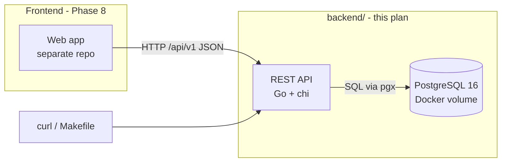
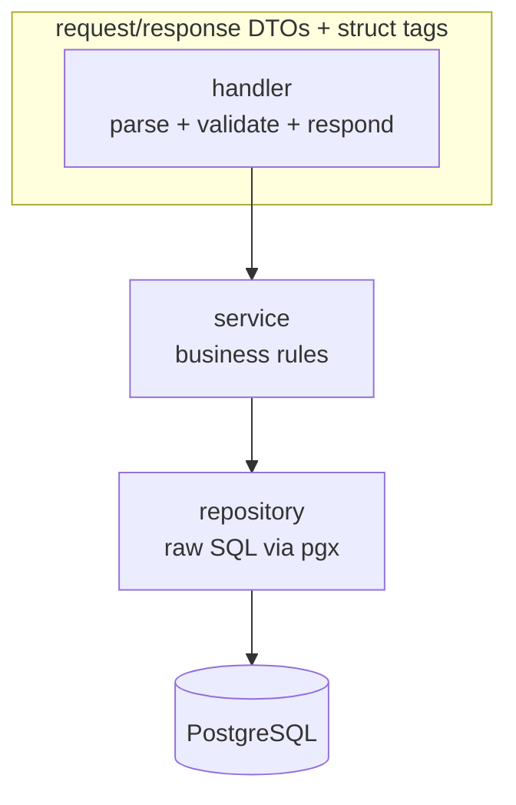
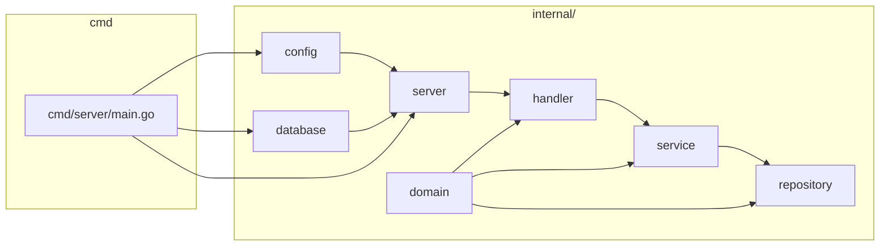
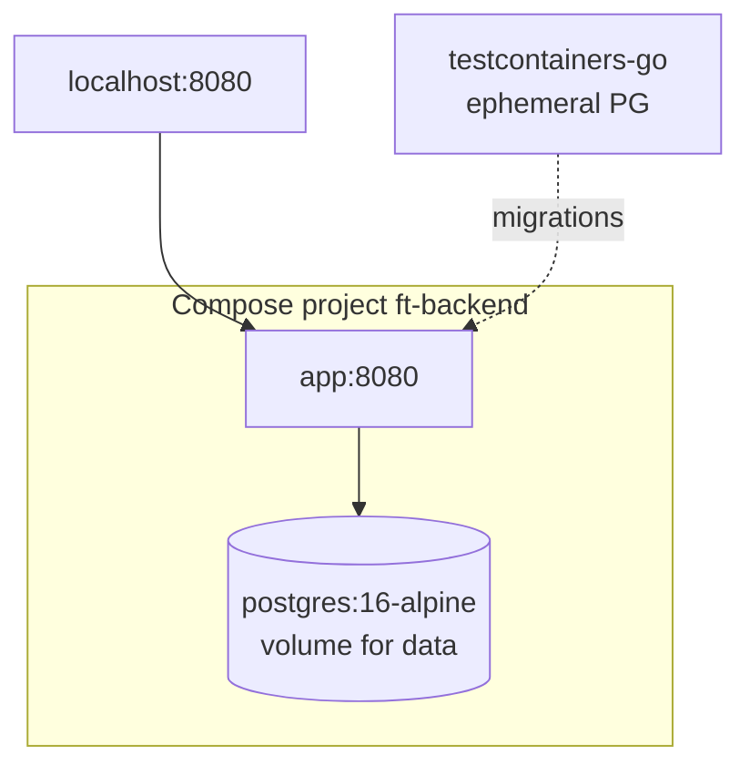

# Target Architecture

**Principle: backend-first, cleanly layered, no magic.** A single Go API server
exposes a REST API consumed later by a separate frontend. All state lives in
PostgreSQL. Nothing is shared with other apps; patterns are reused, code is not.

## System topology



- The API never serves UI assets — it is JSON-only.
- PostgreSQL runs in Docker Compose (dev); production story is out of scope until
  the app proves useful.
- Single-user MVP: one seeded user, `user_id` injected per request (D-003).

## Internal layering

Every feature follows the same three layers; no layer reaches past the next one.



- **handler** — owns HTTP concerns: reading params/bodies, validation (struct tags),
  calling exactly one service method, writing the standard envelope.
- **service** — business rules only: balance updates, budget progress, transfer pair
  creation, multi-currency rules. No SQL.
- **repository** — SQL only. Queries are hand-written, scoped by `user_id` always
  (R1). No business logic.



## Request lifecycle example: create a transaction

```mermaid
sequenceDiagram
    participant C as curl/frontend
    participant H as transaction handler
    participant S as transaction service
    participant R as transaction repository
    participant D as PostgreSQL

    C->>H: POST /api/v1/transactions
    H->>H: validate DTO (UUIDs, signs, date)
    H->>S: CreateTransaction(userID, dto)
    S->>S: resolve account + category (ownership)
    S->>R: BeginTx()
    R->>D: INSERT transaction; UPDATE accounts SET balance = balance + account_amount
    D-->>R: rows affected
    R-->>S: Commit()
    S-->>H: result + new account balance
    H-->>C: 201 { "data": { ... } }
```

In-flight failure of either statement rolls the whole thing back — balance and
transaction can never diverge (§ Balance consistency in `docs/data-model.md`).

## Service shape

- One binary: `cmd/server`; everything under `internal/`.
- Config via environment only (`caarlos0/env`): `DATABASE_URL`, `HTTP_ADDR`, etc.
  Nothing environment-specific is baked into the binary.
- Migrations live in `internal/database/migrations/` (embedded with
  `golang-migrate`), applied via `make migrate`.
- Logging: `log/slog` JSON output in dev and prod alike.

## Database topology



- Compose project `ft-backend`; app port `8080` (dev binds `0.0.0.0`).
- Test suite spins its own ephemeral PostgreSQL via testcontainers — never the dev
  database (Phase 7).

## Why not

| Option | Rejected because |
|---|---|
| ORM (GORM, sqlx row mapper) | Hidden SQL, migration magic, hard to undo (D-002) |
| Microservices | One domain, one binary — split later only with a decision entry |
| GraphQL | REST contract is simpler to version and consume; reports stay read-only queries |
| SQLite | Needs ACID multi-writer safety and the full SQL surface of PostgreSQL |
| Monorepo with frontend | Frontend stack is undecided; separate repos keep Phase 8 frictionless |