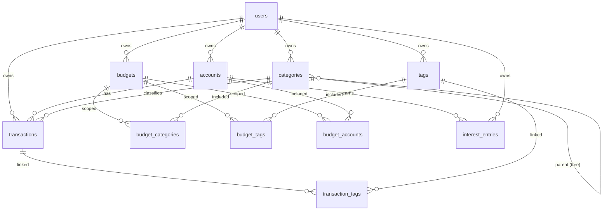

# Data Model

All decisions here trace to `docs/decision-log.md` (D-004…D-011). Money rules are
the non-negotiable core — read §Amounts before touching schema.

## Entity relationship



## Tables

### `users`

Pre-populated for single-user (D-003); enables multi-user later.

| Column | Type | Constraints | Notes |
|---|---|---|---|
| `id` | `UUID` | PK, default `gen_random_uuid()` | |
| `email` | `VARCHAR(255)` | NOT NULL, UNIQUE | |
| `password_hash` | `VARCHAR(255)` | NOT NULL | bcrypt; dummy value for seeded user |
| `display_name` | `VARCHAR(100)` | NOT NULL | |
| `default_currency` | `VARCHAR(3)` | NOT NULL, default `'USD'` | ISO 4217 |
| `created_at` | `TIMESTAMPTZ` | NOT NULL, default `now()` | |
| `updated_at` | `TIMESTAMPTZ` | NOT NULL, default `now()` | |

### `accounts`

| Column | Type | Constraints | Notes |
|---|---|---|---|
| `id` | `UUID` | PK | |
| `user_id` | `UUID` | FK → `users(id)`, NOT NULL | |
| `name` | `VARCHAR(100)` | NOT NULL | e.g. "My Wallet", "EUR Bank Account" |
| `type` | `VARCHAR(20)` | NOT NULL | `checking`, `savings`, `credit_card`, `cash`, `investment` |
| `balance` | `BIGINT` | NOT NULL, default `0` | Cached from transactions, in the account's minor unit |
| `currency` | `VARCHAR(3)` | NOT NULL | Each account has exactly one currency |
| `is_closed` | `BOOLEAN` | NOT NULL, default `false` | Soft close (D-011) |
| `color` | `VARCHAR(7)` | nullable | Hex e.g. `#4CAF50` |
| `created_at` | `TIMESTAMPTZ` | NOT NULL | |
| `updated_at` | `TIMESTAMPTZ` | NOT NULL | |

> `balance` is a denormalized cache updated atomically with every transaction and
> interest entry — never computed lazily on read.

### `categories`

Tree (adjacency list) via `parent_id` (D-004).

| Column | Type | Constraints | Notes |
|---|---|---|---|
| `id` | `UUID` | PK | |
| `user_id` | `UUID` | FK → `users(id)`, NOT NULL | |
| `parent_id` | `UUID` | FK → `categories(id)`, nullable | NULL = root |
| `name` | `VARCHAR(100)` | NOT NULL | |
| `type` | `VARCHAR(10)` | NOT NULL | `income` or `expense` |
| `icon` | `VARCHAR(50)` | nullable | Icon name for UI |
| `sort_order` | `INTEGER` | NOT NULL, default `0` | Sibling ordering |
| `deleted_at` | `TIMESTAMPTZ` | nullable | Soft delete (D-011) |
| `created_at` | `TIMESTAMPTZ` | NOT NULL | |
| `updated_at` | `TIMESTAMPTZ` | NOT NULL | |

**Index:** `(user_id, parent_id)`.

**Tree read (recursive CTE):**

```sql
WITH RECURSIVE cat_tree AS (
  SELECT id, parent_id, name, type, sort_order, 0 AS depth
  FROM categories
  WHERE parent_id IS NULL AND user_id = $1 AND deleted_at IS NULL
  UNION ALL
  SELECT c.id, c.parent_id, c.name, c.type, c.sort_order, ct.depth + 1
  FROM categories c
  JOIN cat_tree ct ON ct.id = c.parent_id
  WHERE c.deleted_at IS NULL
)
SELECT * FROM cat_tree ORDER BY depth, sort_order;
```

### `tags`

| Column | Type | Constraints | Notes |
|---|---|---|---|
| `id` | `UUID` | PK | |
| `user_id` | `UUID` | FK → `users(id)`, NOT NULL | |
| `name` | `VARCHAR(100)` | NOT NULL | Free-text, e.g. "tax-deductible" |
| `created_at` | `TIMESTAMPTZ` | NOT NULL | |

**Unique:** `(user_id, name)`.

### `transaction_tags`

Junction — many-to-many (D-005).

| Column | Type | Constraints |
|---|---|---|
| `transaction_id` | `UUID` | FK → `transactions(id)` ON DELETE CASCADE |
| `tag_id` | `UUID` | FK → `tags(id)` ON DELETE RESTRICT |

**PK:** `(transaction_id, tag_id)`.

### `transactions`

| Column | Type | Constraints | Notes |
|---|---|---|---|
| `id` | `UUID` | PK | |
| `user_id` | `UUID` | FK → `users(id)`, NOT NULL | |
| `account_id` | `UUID` | FK → `accounts(id)`, NOT NULL | |
| `category_id` | `UUID` | FK → `categories(id)`, nullable | NULL for transfers |
| `transfer_pair_id` | `UUID` | nullable | Set when part of a transfer pair (D-008) |
| `description` | `TEXT` | nullable | |
| `date` | `DATE` | NOT NULL | User-chosen transaction date |
| `original_amount` | `BIGINT` | NOT NULL | Signed, original currency's minor unit (D-007, D-010) |
| `original_currency` | `VARCHAR(3)` | NOT NULL | ISO 4217 |
| `account_amount` | `BIGINT` | NOT NULL | Signed, account currency's minor unit; same sign as `original_amount` |
| `is_reconciled` | `BOOLEAN` | NOT NULL, default `false` | Verified against bank statement |
| `created_at` | `TIMESTAMPTZ` | NOT NULL | |
| `updated_at` | `TIMESTAMPTZ` | NOT NULL | |

**Indexes:**
- `(user_id, date DESC)` — primary query pattern
- `(user_id, transfer_pair_id)` — both legs of a transfer
- `(user_id, account_id, date DESC)` — account queries
- `(user_id, category_id)` — category filtering
- `(user_id, original_currency)` — currency filtering

### `budgets`

| Column | Type | Constraints | Notes |
|---|---|---|---|
| `id` | `UUID` | PK | |
| `user_id` | `UUID` | FK → `users(id)`, NOT NULL | |
| `name` | `VARCHAR(100)` | NOT NULL | e.g. "Dining Out" |
| `amount` | `BIGINT` | NOT NULL | Limit in the budget's currency, minor units |
| `currency` | `VARCHAR(3)` | NOT NULL | |
| `period` | `VARCHAR(10)` | NOT NULL | `weekly`, `monthly`, `yearly`, `custom` |
| `period_start` | `DATE` | NOT NULL | |
| `period_end` | `DATE` | nullable | Required for `custom`; NULL = indefinite for periodic |
| `rollover` | `BOOLEAN` | NOT NULL, default `false` | Unused amount rolls to next period (v1: stored, behavior later) |
| `scope_type` | `VARCHAR(10)` | NOT NULL, default `'all'` | `all`, `categories`, `tags`, `accounts`, `mixed` (D-006) |
| `created_at` | `TIMESTAMPTZ` | NOT NULL | |
| `updated_at` | `TIMESTAMPTZ` | NOT NULL | |

### Budget scope junctions

| Table | Columns | FK |
|---|---|---|
| `budget_categories` | `budget_id`, `category_id` | both CASCADE |
| `budget_tags` | `budget_id`, `tag_id` | both CASCADE |
| `budget_accounts` | `budget_id`, `account_id` | both CASCADE |

**PK** of each: `(budget_id, member_id)`.

**Scope semantics (D-006):**

| scope_type | Matching rule |
|---|---|
| `all` | any transaction in the period |
| `categories` | category ∈ `budget_categories` (children do **not** auto-inherit) |
| `tags` | transaction has ≥ 1 tag ∈ `budget_tags` |
| `accounts` | account ∈ `budget_accounts` |
| `mixed` | (category ∈ cats) AND (tags ≥ 1) AND (account ∈ accounts); an empty set in any dimension is treated as "any" |

### `interest_entries`

| Column | Type | Constraints | Notes |
|---|---|---|---|
| `id` | `UUID` | PK | |
| `account_id` | `UUID` | FK → `accounts(id)`, NOT NULL | |
| `user_id` | `UUID` | FK → `users(id)`, NOT NULL | Denormalized for query scoping |
| `amount` | `BIGINT` | NOT NULL | Minor units; positive = earned, negative = charged |
| `date` | `DATE` | NOT NULL | |
| `note` | `TEXT` | nullable | |
| `created_at` | `TIMESTAMPTZ` | NOT NULL | |

**Index:** `(account_id, date DESC)`.

Separate from transactions on purpose (D-009): interest reports aggregate directly
off this table.

## Amounts (D-007, D-010)

**Every money column is `BIGINT` in the currency's minor unit, signed:**
income/debit-in → positive; expense/debit-out → negative.

Transactions carry two amounts, both **entered by the user** — nothing is computed:

| Field | Meaning |
|---|---|
| `original_amount` | The transaction as it happened, in its own currency |
| `original_currency` | ISO 4217 code of that currency |
| `account_amount` | Impact on the account balance, in the account's currency |

Rules:

- `original_amount` and `account_amount` always share the same sign (validation on
  the API boundary — R3).
- Same currency (account currency = original currency) ⇒ `account_amount` may be
  omitted by the client; server stores it equal to `original_amount`.
- Exchange rate is **not stored**; when display needs it: `|account_amount| ÷
  |original_amount|`.

Examples (USD account):

| Scenario | `original_amount` | `original_currency` | `account_amount` |
|---|---|---|---|
| Spend $50 from USD account | `-5000` | USD | `-5000` |
| Earn €100 into USD account | `10000` | EUR | `10500` |
| Buy £30 from EUR account (EUR account row) | `-3000` | GBP | `-3540` |

## Balance consistency

Every operation touching an account balance runs in one DB transaction;

```sql
BEGIN;
  INSERT INTO transactions (id, user_id, account_id, category_id, transfer_pair_id,
                            description, date, original_amount, original_currency,
                            account_amount)
  VALUES (gen_random_uuid(), $1, $2, $3, NULL, $4, $5, $6, $7, $8);
  UPDATE accounts
     SET balance = balance + $8, updated_at = now()
   WHERE id = $2 AND user_id = $1;
COMMIT;
```

- **Update:** reverse the old `account_amount`, apply the new one — same tx.
- **Delete:** `UPDATE accounts SET balance = balance - account_amount`.
- **Interest entry:** identical pattern, `interest_entries.amount` replaces
  `account_amount`.
- **Transfer (D-008):** both legs + both balance updates in one tx — see below.

Failure anywhere ⇒ full rollback; balance and ledger can never diverge.

## Transfers (D-008)

A transfer is **two transaction rows sharing one `transfer_pair_id`**:

- **Outgoing leg** — source account, negative `account_amount`, `category_id` NULL.
- **Incoming leg** — destination account, positive `account_amount`, `category_id`
  NULL.

```sql
BEGIN;
  -- outgoing leg
  INSERT INTO transactions (id, account_id, user_id, transfer_pair_id, description,
                            date, original_amount, original_currency, account_amount)
  VALUES (gen_random_uuid(), $from_account, $1, $pair_id, $desc, $date,
          $out_original, $out_currency, $from_amount);
  UPDATE accounts SET balance = balance + $from_amount
   WHERE id = $from_account AND user_id = $1;

  -- incoming leg
  INSERT INTO transactions (id, account_id, user_id, transfer_pair_id, description,
                            date, original_amount, original_currency, account_amount)
  VALUES (gen_random_uuid(), $to_account, $1, $pair_id, $desc, $date,
          $in_original, $in_currency, $to_amount);
  UPDATE accounts SET balance = balance + $to_amount
   WHERE id = $to_account AND user_id = $1;
COMMIT;
```

Rules:

- Both legs share one generated `pair_id`; `GET /transactions?transfer_id=<pair>`
  returns both.
- Transfers are **excluded** from budgets and income/expense reports:
  `transfer_pair_id IS NULL` in those queries.
- Update/delete a transfer ⇒ operate on both legs atomically.
- Same-currency pair: `original_amount = account_amount` on both legs.

## Budget progress query

```sql
SELECT COALESCE(SUM(t.account_amount), 0) AS spent
FROM transactions t
LEFT JOIN transaction_tags tt ON tt.transaction_id = t.id
WHERE t.user_id = $1
  AND t.date >= $2                      -- period start
  AND t.date <= $3                      -- period end
  AND t.transfer_pair_id IS NULL        -- transfers are not spending (D-008)
  AND t.account_amount < 0              -- expenses only
  AND (t.category_id = ANY($4)          -- scope: categories
    OR EXISTS (SELECT 1 FROM budget_tags bt
                WHERE bt.budget_id = $5 AND bt.tag_id = tt.tag_id)  -- scope: tags
    OR t.account_id = ANY($6));         -- scope: accounts
```

`mixed` scopes combine the dimensions with AND (empty dimension = "any") — the query
is built per dimension presence, never with a fixed OR chain (R2).